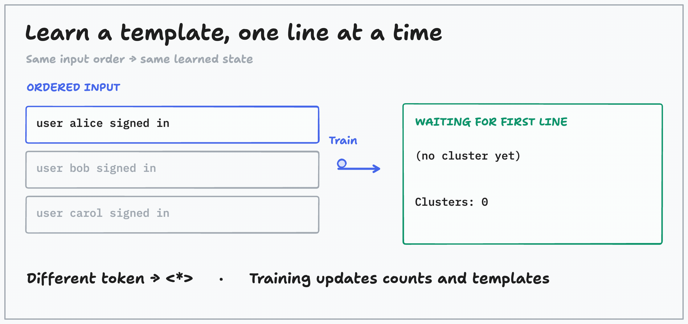
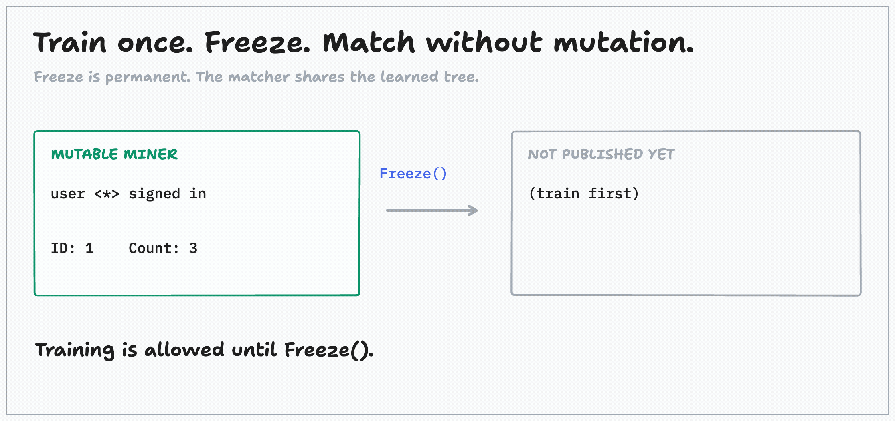

# drain3-go

Streaming Drain log templates in Go. **Go 1.23+ · zero runtime dependencies · experimental API.**

## Measured results

80,000 invented lines per dataset; median of five isolated process runs.

| Input | Parser | Train ms | Match ms | Peak RSS MiB |
|---|---|---:|---:|---:|
| Short | **drain3-go** | 24.87 | 21.01 | 11.14 |
| Short | Kloudmate | 26.69 | 22.59 | 11.09 |
| 2 KiB/line | **drain3-go** | 408.28 | 396.71 | 11.23 |
| 2 KiB/line | Kloudmate | 304.37 | 300.59 | 11.17 |

macOS/arm64, Go 1.25.11. Includes streaming I/O; **excludes preprocessing and retained input**. Not a general speedup or service-memory claim. drain3-go is slower than Kloudmate on the long input here. [Clean-build provenance, settings, raw runs, reproduction →](docs/benchmarks/README.md)

**Correctness checks:** 143 synthetic cases, 10,322 training steps, and 2,210 queries × three search strategies. Both Go parsers agree on every training and frozen assignment, template, and count in both benchmark datasets. Self-verification, not independent review or universal parity. [Tests and scope →](bench/README.md)

## Watch it work

### Learn in order

<picture>
  <source media="(prefers-reduced-motion: reduce)" srcset="https://raw.githubusercontent.com/sematext/drain3-go/master/docs/assets/learn.png">
  
</picture>

### Freeze, then match without mutation

<picture>
  <source media="(prefers-reduced-motion: reduce)" srcset="https://raw.githubusercontent.com/sematext/drain3-go/master/docs/assets/freeze.png">
  
</picture>

Animations play once and stop. **Static:** [learn](docs/assets/learn.png) · [freeze](docs/assets/freeze.png). Made with tldraw; [editable drawings and renderer](docs/visuals/README.md).

## Use it

```sh
go get github.com/sematext/drain3-go
```

Import as `drain3 "github.com/sematext/drain3-go"`. `Train` learns in caller-defined order; `Freeze` permanently ends training; `Match` is read-only and concurrent-safe. [Runnable example](example_test.go) · [API and bounds](docs/api.md)

## Know the edges

- **Matching defaults:** exact ties prefer **more wildcards**, which can merge useful distinctions. This is not Kloudmate's specificity preference. [Matching rules](docs/semantics.md)
- **Bounds default to unlimited.** Set `MaxClusters`, `MaxLineBytes`, and `MaxTokens` for untrusted input. Failures return errors, not silent eviction/truncation. These are **not an RSS cap**; caller buffering and concurrency still matter.
- Regex syntax and Unicode behavior follow Go. `\d`, `\w`, and `\s` are ASCII classes. Sequential masks can produce overlapping parameter spans. [Compatibility details](docs/api.md#compatibility)
- No LRU eviction, persistence, snapshot compatibility, or token interner.

Apache-2.0. Based on [Akshat Agarwal's Drain3](https://github.com/akshatagarwl/drain3/tree/9d5e8e8cad620bc2b83064e8c67e29affccf571c). [LICENSE](LICENSE) · [NOTICE](NOTICE) · [Provenance / upstream attribution](PROVENANCE.md) · [Third-party notices](third_party)
